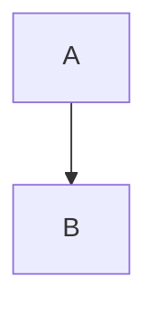

# Dogfood Fixture

A **bold** claim, an [okuda link](https://github.com/x/okuda), inline `code span`,
a bare https://example.com/url. Now td-1692ee, td-8ece4e, ADR-028, ADR-013, TTS.
Callsigns BRF-ONION-SEARCH-GRAMMAR, BRF-TTS-TEMPORAL, and standalone BRF.
Written 2026-09-14, covering briefs/2026-07-14-brief-locus-tag-consumer.md
and src/render.ts. JSONL, OKLCH, the mind → machine pipeline. A mid dot · test.
Logged 14:32, resumed 16:07. The 2020-03-01 entry predates all of this.
A wired line %%okuda-rhs:15%% and a table-wire form
<!-- %%okuda-rhs:44%% okuda wire --> for the ear to ignore.

## Section Two

- first item with a lazy
  continuation line
- [x] done task
- [ ] open task
1. numbered one
2. numbered two



```bash
echo hidden code fence
```

| Layer | Owner |
|-------|-------|
| Rendering | okuda |
| Windowing | Herdr |
| Speech | the sibling silo <!-- %%okuda-rhs:13%% wire --> with `code` in flight |

> A quoted line for Moira.

---

Free paragraph with a wrapped
continuation inside it.

I read them all, for I count sleep an interruption. Most of it is shite,
the pass predicted. So we have read the whole corpus.
